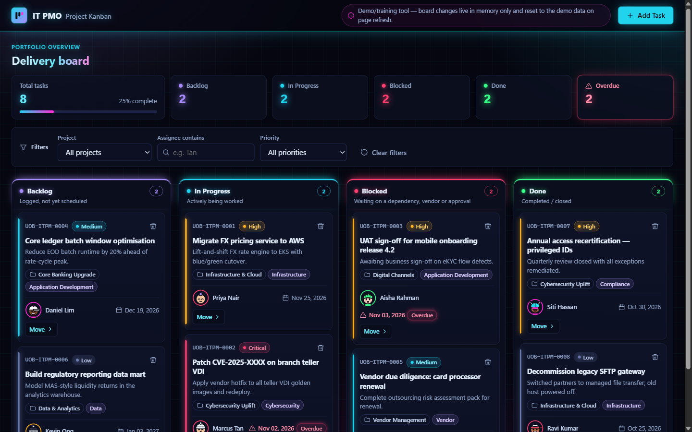

# IT PMO Kanban Board


A single-file Kanban board for an IT Project Management Office, built for internal demos and training. The bank it depicts is **fictitious**. It has no real branding and is not affiliated with any real institution or system. Task IDs (`UOB-ITPM-####`) and the email subject prefix are plain text strings required by the demo spec.

**Live demo:** https://ekuantan.github.io/it-pmo-kanban/



*Screenshot of the redesigned board, captured with the Playwright MCP tool at 1440×900.*

## Design

The interface was redesigned with the **ui-ux-pro-max** Agent Skill (installed in `.claude/skills/`):

- **Neon theme:** cyan and magenta glows on a near-black background with a faint grid, based on the skill's HUD and dark-mode styles. Glitch and scanline effects were left out to keep text readable.
- **Summary tiles:** a count for each status in its own colour, an Overdue tile and a completion meter.
- **Cards:** a priority stripe and label, project and category tags, the due date (red with a warning icon when overdue) and an original cartoon avatar for each assignee. Avatars are drawn as inline SVG and picked from the person's name.
- **Accessibility:** visible focus rings, 44px touch targets on touch screens, and motion turned off when the system asks for reduced motion.

## Features

- **Four columns:** Backlog, In Progress, Blocked and Done, each with a count badge, plus summary tiles for the whole board.
- **Filters:** by project, by assignee (text contains) and by priority, with a "Clear filters" button.
- **Moving cards:** native drag-and-drop, or the keyboard-accessible "Move" menu on each card.
- **Add Task form:** a modal with inline validation messages under each field.
- **Overdue badges:** cards whose due date has passed and that are not Done get an Overdue badge. Seed due dates are relative to today, so the demo always shows some.
- **Inline delete confirmation:** "Delete this task? Yes / No" on the card, with no browser pop-ups.
- **Email notification:** adding a task sends an email through [FormSubmit](https://formsubmit.co).
- **No persistence:** refreshing the page resets the board to the seed data. This is intentional.

## Run it locally

Double-click `index.html` to open it in your browser. No server or install is needed.

If the FormSubmit request fails with a CORS error from `file://`, serve the folder instead:

```bash
python -m http.server 8000
```

Then open http://localhost:8000/.

## Email notifications (FormSubmit)

When a task is added, the app first adds the card to the board, then POSTs it to FormSubmit's AJAX endpoint. While it sends, the submit button shows "Sending…". If the request fails or times out after 15 seconds, a warning toast says the card was added locally but the email failed. The board is never affected.

To set it up:

1. Open `index.html` and change the email address in the `FORMSUBMIT_ENDPOINT` constant at the top of the `<script>` block. This is the only place it appears. The repo ships with the placeholder `YOUR_EMAIL@example.com`.
2. Add a task once. FormSubmit sends a **one-time activation email** to that address.
3. Click the activation link. Nothing is delivered until you do.

Note that any address you put in `FORMSUBMIT_ENDPOINT` becomes public if you commit it to a public repo.

## Tech constraints

- Vanilla HTML, CSS and JavaScript in one file (`index.html`). No frameworks, libraries, build step or npm.
- Works when opened directly from disk (`file://`).
- No external resources: no CDNs, web fonts or image files. It uses the system font stack and inline SVG icons and avatars.
- No storage APIs: no localStorage, sessionStorage, IndexedDB or cookies.
- The only network call is the FormSubmit endpoint.

See [CLAUDE.md](CLAUDE.md) for the full architecture notes.

## CI/CD

Two GitHub Actions workflows live in `.github/workflows/`:

- **`ci.yml` (CI):** runs on every push and pull request to `main`. It checks that:
  - `index.html` is well-formed (starts with a doctype, with balanced `<script>` and `<style>` tags)
  - no forbidden APIs or `!important` are used
  - no URL other than `FORMSUBMIT_ENDPOINT` appears
  - no external resources are loaded

  It also runs a [gitleaks](https://github.com/gitleaks/gitleaks) secret scan over the full git history.
- **`pages.yml` (Deploy to GitHub Pages):** runs after CI succeeds on a push to `main`, and can also be started by hand. It publishes only `index.html` to GitHub Pages.
